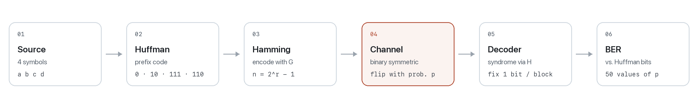
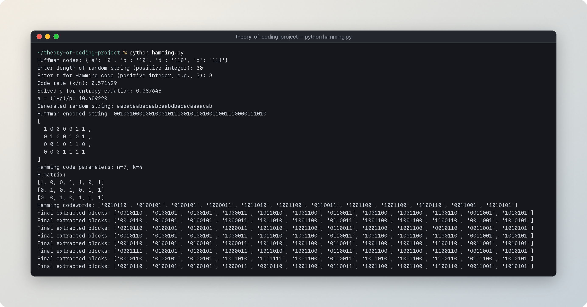
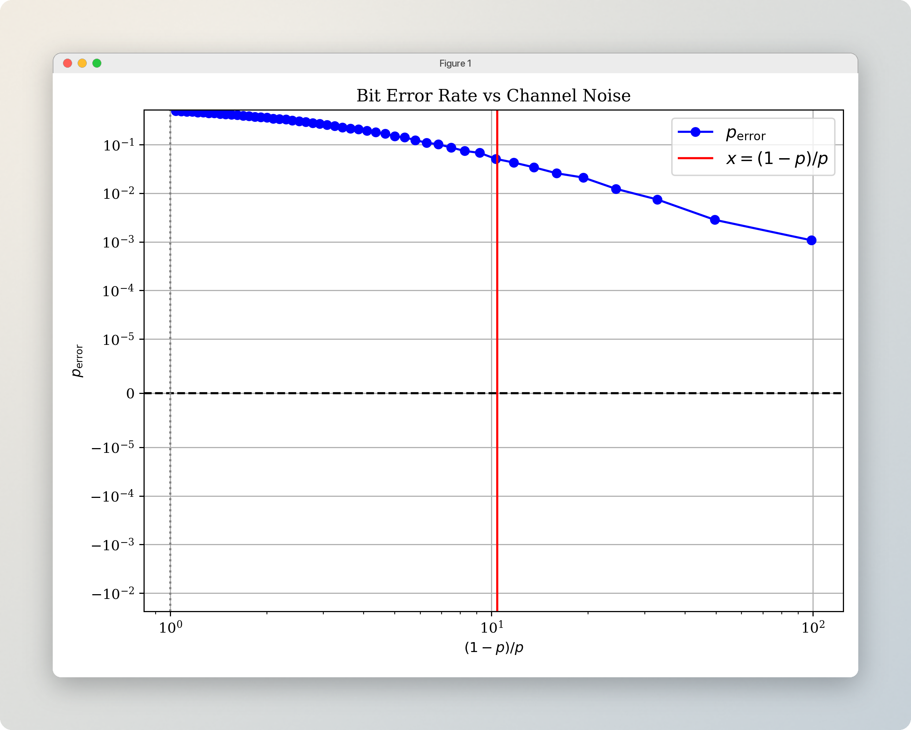

<p align="center">
  
</p>

<p align="center">
  A compact simulation of a complete digital communication link:<br>
  compress a source with <b>Huffman coding</b>, protect it with a <b>Hamming code</b>, send it through a noisy channel,<br>
  decode it, and measure how close the result comes to the <b>Shannon limit</b>.
</p>

<p align="center">
  <a href="#quick-start">Quick start</a> &nbsp;·&nbsp;
  <a href="#a-run-step-by-step">A run, step by step</a> &nbsp;·&nbsp;
  <a href="#reading-the-plot">Reading the plot</a> &nbsp;·&nbsp;
  <a href="#how-it-works">How it works</a>
</p>

<br>

<p align="center">
  <a href="assets/demo.mp4">
    
  </a>
  <br>
  <sub>A full run with 5,000 symbols and r = 3. &nbsp;<a href="assets/demo.mp4">Full-resolution recording (MP4)</a></sub>
</p>

<br>

## Overview

The project follows a message from source to sink. A random string is drawn from a four-symbol alphabet with known probabilities, compressed into a bitstream with an optimal prefix code, then split into blocks and encoded with a Hamming *(n, k)* code built at runtime from a single parameter *r*.

Each codeword then passes through a **binary symmetric channel** that flips every bit independently with probability *p*. A syndrome decoder corrects single-bit errors, the data bits are pulled out again, and the **bit error rate** is measured against the original Huffman bitstream. The experiment repeats for 50 noise levels and is plotted against the theoretical threshold implied by the code rate.

<picture>
  <source media="(prefers-color-scheme: dark)" srcset="assets/pipeline-dark.png">
  
</picture>

<br>

## Quick start

Python 3.8 or later.

```bash
git clone https://github.com/elham-cheraghi/theory-of-coding-project.git
cd theory-of-coding-project
pip install -r requirements.txt
python hamming.py
```

The script asks for two values:

| Prompt | Meaning | Try |
| :-- | :-- | :-- |
| `Enter length of random string` | Number of source symbols to generate | `5000` |
| `Enter r for Hamming code` | Number of parity bits; sets the block length *n* = 2<sup>*r*</sup> − 1 | `3` |

When the simulation finishes, a Matplotlib window opens with the bit-error-rate curve.

> [!TIP]
> Every intermediate bitstream is printed in full, once per noise level. Keep the length small (around `30`) to read the output line by line, or use a few thousand symbols for a smooth curve.

<br>

## A run, step by step

<p align="center">
  
</p>

Reading the output from top to bottom:

1. **Huffman code.** A tree is built for the source `a, b, c, d` with probabilities `0.4, 0.3, 0.2, 0.1`, giving the codewords below.
2. **Code rate and threshold.** For the chosen *r*, the program reports the rate *k/n*, solves for the crossover probability *p\** at which channel capacity equals that rate, and prints the matching value of (1 − *p\**) / *p\**.
3. **Source and compressed stream.** The random string and its Huffman-encoded bitstream.
4. **Generator matrix G.** Built in systematic form, so the first *k* bits of every codeword are the data bits.
5. **Parity-check matrix H.** Used by the decoder to compute syndromes.
6. **Codewords.** The bitstream, padded and split into *k*-bit blocks, each encoded into *n* bits.
7. **Decoded blocks.** One line per noise level: the codewords after noise and single-error correction.

| Symbol | Probability | Codeword |
| :-: | :-: | :-: |
| `a` | 0.4 | `0` |
| `b` | 0.3 | `10` |
| `c` | 0.2 | `111` |
| `d` | 0.1 | `110` |

The average codeword length is **1.90 bits per symbol** against a source entropy of **1.846 bits**, an efficiency of about 97%.

<br>

## Reading the plot

<p align="center">
  
  <br>
  <sub>20,000 symbols, r = 3 (Hamming (7, 4)).</sub>
</p>

The horizontal axis is (1 − *p*) / *p*, the odds that a bit survives the channel. Moving right means a cleaner channel. The vertical axis is the measured bit error rate after decoding, on a symmetric log scale so that a perfect run (zero errors) still has a place on the chart.

The **red line** marks the Shannon threshold for the code's rate *R* = *k/n*. It is the crossover probability *p\** at which the capacity of the binary symmetric channel equals the rate:

$$
1 - H_2(p^\ast) = \frac{k}{n},
\qquad
H_2(p) = -p\log_2 p - (1-p)\log_2(1-p)
$$

To the left of the line no code of this rate can be made arbitrarily reliable. To the right, Shannon's theorem says reliable codes exist. The gap between the blue curve and zero, on the right of the line, shows how far a short single-error-correcting code is from that ideal.

| *r* | *n* | *k* | Rate *k/n* | *p\** | (1 − *p\**) / *p\** |
| :-: | :-: | :-: | :-: | :-: | :-: |
| 3 | 7 | 4 | 0.571 | 0.0876 | 10.41 |
| 4 | 15 | 11 | 0.733 | 0.0454 | 21.01 |
| 5 | 31 | 26 | 0.839 | 0.0236 | 41.34 |

<br>

## How it works

Everything lives in a single script, [`hamming.py`](hamming.py).

| Stage | Functions | What happens |
| :-- | :-- | :-- |
| Source | `generate_random_string` | Draws symbols according to the given probabilities |
| Compression | `build_huffman_tree`, `generate_huffman_codes`, `huffman_decode` | Builds the tree with a min-heap and assigns prefix-free codewords |
| Code construction | `build_H_matrix`, `standardize_H`, `build_G_matrix`, `left_identity_form` | Lists every non-zero *r*-bit column to form **H**, rearranges it to standard form, and derives a systematic **G** by row reduction over GF(2) |
| Encoding | `hamming_encode` | Pads the bitstream to a multiple of *k* and multiplies each block by **G** (mod 2) |
| Channel | `add_noise` | Draws the number of flips from a binomial distribution and places them uniformly in each codeword |
| Decoding | `hamming_decode`, `extract_message` | Computes the syndrome, flips the indicated bit, and keeps the first *k* positions |
| Analysis | `solve_for_p` | Solves 1 − *H*<sub>2</sub>(*p*) = *k/n* numerically with `scipy.optimize.fsolve` |
| Plot | — | Sweeps *p* from 0.01 to 0.49 in 50 steps and plots bit error rate against (1 − *p*) / *p* |

<br>

## Project layout

```text
theory-of-coding-project/
├── hamming.py          # the full simulation
├── requirements.txt    # numpy, scipy, matplotlib
└── assets/             # images and the demo recording used in this README
```

<br>

## Background

| Concept | In one line |
| :-- | :-- |
| **Huffman coding** | Optimal prefix code for a known source distribution; average length lies within one bit of the entropy |
| **Hamming code** | Perfect linear block code with minimum distance 3; corrects any single error per block |
| **Binary symmetric channel** | Each bit is flipped independently with probability *p* |
| **Shannon limit** | Below capacity, the error probability can be made arbitrarily small; above it, it cannot |

<br>

---

<p align="center">
  <sub>Developed for the <b>Theory of Coding</b> course. You are welcome to reuse or extend it for learning and research with proper credit.</sub>
</p>
